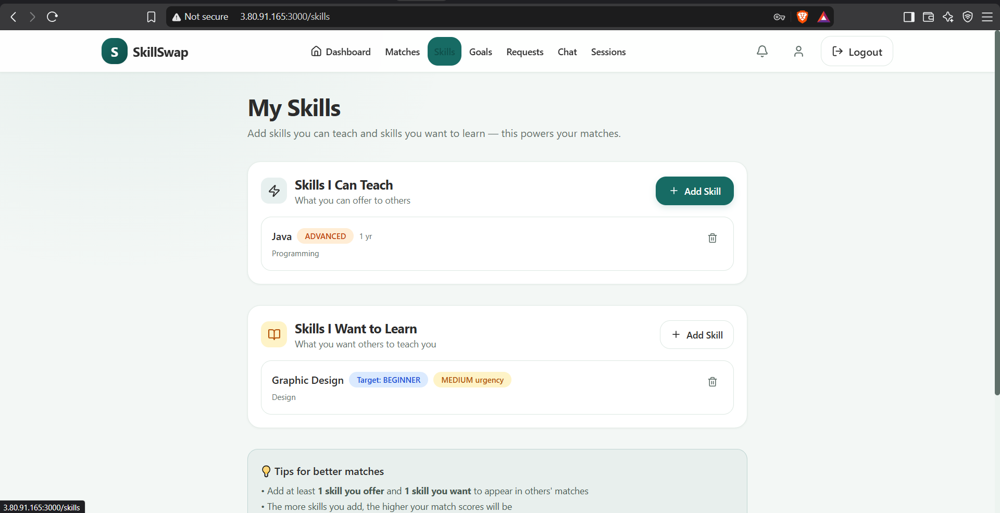
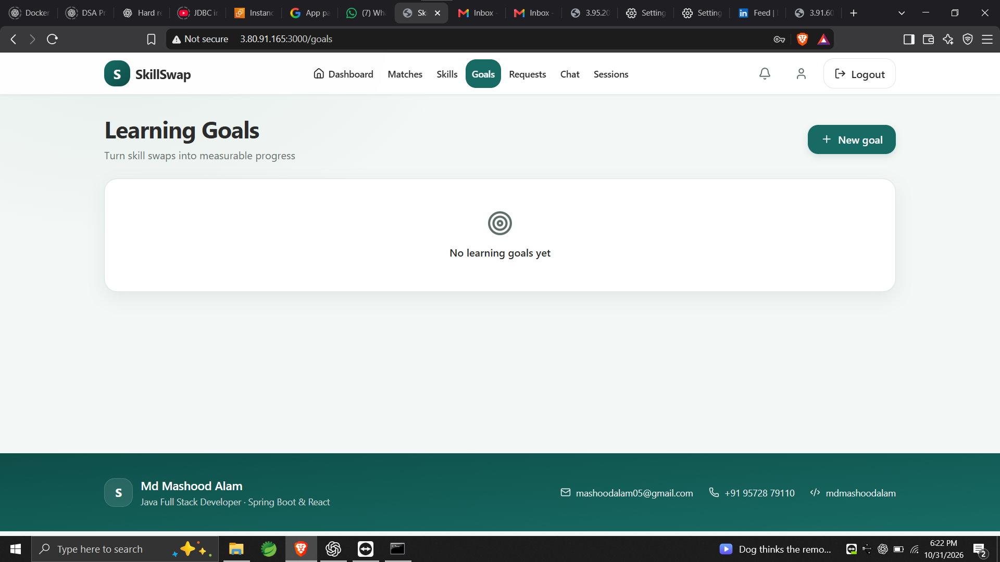
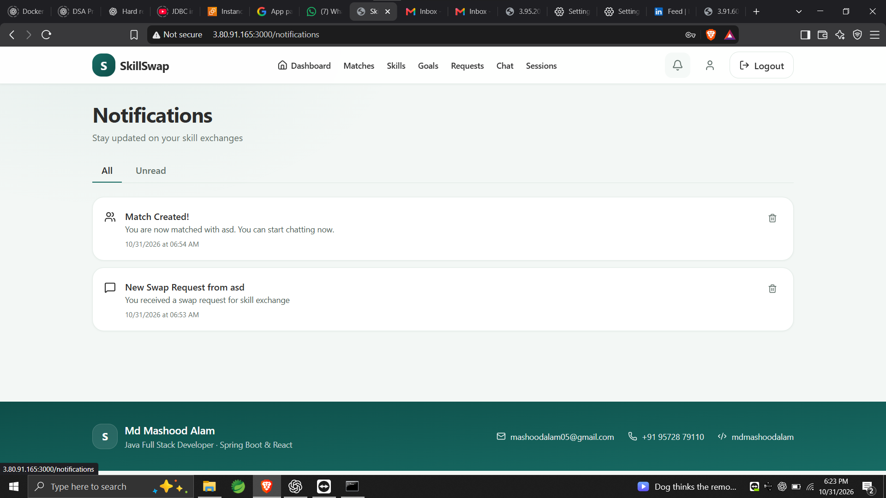

# Skill Swap Platform

A full-stack community platform for matching people with complementary skills, managing swap requests and learning sessions, chatting in real time, making voice/video calls, and exchanging reviews.

## Screenshots

### Sign in


### Dashboard


### Skills



### User profile


### Learning goals



### Notifications



### Admin panel


## Included functionality

- Explainable compatibility matching with search, score filters, block filtering, and favorite people
- Detailed swap proposals with selected skills, preferred mode, proposed time, and duplicate protection
- Session scheduling, rescheduling, cancellation/completion, calendar (`.ics`) export, and completed-session reviews
- Real-time STOMP notifications and chat with typing state, read receipts, replies, edits, soft deletes, images, and file attachments
- WebRTC voice/video signalling with configurable STUN/TURN servers
- Learning goals, progress tracking, profile achievements, ratings, and review history
- User blocking and reporting, account suspension/deactivation, and an admin moderation queue
- Email verification and password-reset flows using expiring, SHA-256-hashed one-time tokens
- API rate limiting, Actuator health/metrics, route-level frontend code splitting, and Docker deployment

## Stack

- React 19, Vite, React Router, Tailwind CSS
- Spring Boot 3.5, Spring Security, JWT, JPA, WebSocket/STOMP
- MySQL 8+
- Java 21 and Node.js 20+

## Local setup

Create an empty MySQL database named `skill_swap`, then set the runtime configuration. In PowerShell:

```powershell
$env:DB_URL = "jdbc:mysql://localhost:3306/skill_swap"
$env:DB_USERNAME = "root"
$env:DB_PASSWORD = "your-database-password"
$env:JWT_SECRET = "replace-with-a-random-secret-of-at-least-32-characters"
$env:ADMIN_EMAIL = "admin@skillswap.com"
$env:ADMIN_PASSWORD = "replace-with-a-strong-initial-admin-password"
```

`ADMIN_PASSWORD` is optional. The initial admin is created only when it is set, which avoids shipping a predictable administrator credential. It is only used if the configured admin email does not already exist.

Start the backend:

```powershell
cd backend
mvn spring-boot:run
```

Start the frontend in another terminal:

```powershell
cd frontend
npm install
npm run dev
```

The frontend defaults to `http://localhost:5173` and the API to `http://localhost:8080/api`. For other environments, set `VITE_API_URL`, `VITE_BASE_URL`, and the backend's comma-separated `CORS_ALLOWED_ORIGINS`.

For local development, verification and password-reset links are written to the backend log when SMTP is not configured. To deliver email, set `MAIL_HOST`, `MAIL_PORT`, `MAIL_USERNAME`, `MAIL_PASSWORD`, and `MAIL_FROM` in the backend environment (or the root `.env` when using Docker Compose). SMTP authentication and STARTTLS are enabled by default. Set `MAIL_LOG_LINKS=false` in production so a missing SMTP setup fails visibly instead of logging token links.

Users can sign in before verifying their address, but verification is required before using protected `/api/**` endpoints or connecting to chat and call WebSockets. The current user endpoint and verification resend endpoint remain available so unverified users can complete verification.

## Docker setup

Copy `.env.example` to `.env`, replace every placeholder secret, then run:

```powershell
docker compose up --build
```

The app is available at `http://localhost:3000`; MySQL, uploaded files, and compressed database backups are stored in named volumes. The frontend container proxies `/api`, `/ws`, and `/uploads` to the backend. The backend health endpoint is `http://localhost:8080/actuator/health` inside the Docker network; Docker uses it to determine whether the backend is healthy before starting the frontend. Container output, including structured backend logs and backup status, is available with `docker compose logs -f backend database-backup`.

### Runtime configuration

For Docker Compose, set these in the root `.env` file. Values marked “required” must be replaced before startup.

| Variable | Default | Purpose |
| --- | --- | --- |
| `DB_PASSWORD` | required | Application database password; also used by the backup job. |
| `DB_ROOT_PASSWORD` | required | MySQL root password. |
| `JWT_SECRET` | required, at least 32 bytes | Signs authentication tokens. |
| `ADMIN_EMAIL` | `admin@skillswap.local` | Email address for the optional initial admin. |
| `ADMIN_PASSWORD` | empty | Creates the initial admin only when set. |
| `APP_ORIGIN` | `http://localhost:3000` | Frontend origin allowed by the API and used to build email links. |
| `JPA_DDL_AUTO` | `update` | Hibernate schema behavior; use migrations and a non-updating setting for production. |
| `BACKUP_INTERVAL_SECONDS` | `86400` | Time between compressed database backups (one day). |
| `BACKUP_RETENTION_DAYS` | `14` | Number of days of backups retained in the `database-backups` volume. |
| `MAIL_HOST`, `MAIL_PORT`, `MAIL_USERNAME`, `MAIL_PASSWORD`, `MAIL_FROM` | blank, `587`, blank, blank, blank | SMTP server and sender configuration. |
| `MAIL_SMTP_AUTH`, `MAIL_SMTP_STARTTLS` | `true` | SMTP authentication and STARTTLS settings. |
| `MAIL_LOG_LINKS` | `true` | Logs verification/reset links when mail is unavailable; turn off for production. |

For local backend runs, the app also supports `DB_URL` (defaults to localhost MySQL), `DB_USERNAME`, `JWT_EXPIRATION_MS` (defaults to 86400000), `UPLOAD_DIR` (defaults to `uploads`), `CORS_ALLOWED_ORIGINS` (defaults to localhost ports 3000 and 5173), `FRONTEND_URL` (defaults to port 5173), `RATE_LIMIT_ENABLED` (defaults to true), `AUTH_RATE_LIMIT_PER_MINUTE` (15), `API_RATE_LIMIT_PER_MINUTE` (180), and `TRUST_FORWARDED_HEADER` (false). Frontend builds support `VITE_API_URL`, `VITE_BASE_URL`, and `VITE_ICE_SERVERS` (a JSON array of ICE/TURN servers).

### Database backups and restore

The Compose backup service takes its first backup after MySQL becomes healthy, then repeats at the configured interval. Backups are gzip-compressed SQL files in the `database-backups` named volume. Copy a backup to the host before keeping it outside this Compose installation:

```powershell
docker compose exec database-backup ls -lh /backups
docker compose cp database-backup:/backups/skill_swap_YYYYMMDDTHHMMSSZ.sql.gz .
```

To restore a copied backup, stop the backend, copy the file into the backup container, restore it, and start the backend again. Replace the example filename with the file you copied:

```powershell
docker compose stop backend
docker compose cp .\skill_swap_YYYYMMDDTHHMMSSZ.sql.gz database-backup:/backups/restore.sql.gz
docker compose exec database-backup bash -lc 'gzip -dc /backups/restore.sql.gz | mysql --host="$DB_HOST" --user="$DB_USER" "$DB_NAME"'
docker compose up -d backend
```

Backups in the named volume are local to this Docker installation. For production, regularly copy them to encrypted off-host storage and practice restoring them.

## Verification

```powershell
cd backend
mvn test

cd ..\frontend
npm run build
```

Backend regression tests cover authentication and email verification, upload signature validation, profile updates, recommendation filtering/scoring, swap-skill ownership, session participant integrity, and completed-session review rules.

## Production notes

- Supply unique `JWT_SECRET`, database, admin, upload-directory, and CORS values through environment variables.
- Set valid SMTP credentials and `MAIL_FROM`, then set `MAIL_LOG_LINKS=false` before inviting real users.
- Set `VITE_ICE_SERVERS` at frontend build time to a JSON array containing your authenticated TURN service. Public STUN alone is not reliable for all networks.
- Use schema migrations and change `spring.jpa.hibernate.ddl-auto` from `update` before production deployment.
- Store uploaded media in durable object storage when running more than one backend instance.
- Replace the in-memory API limiter with a Redis-backed limiter when running multiple backend instances.
- Use HTTPS; browser camera and microphone access is restricted on non-secure remote origins.
- Set `MAIL_LOG_LINKS=false` explicitly in production and protect access to container logs; they can contain sensitive operational details.
